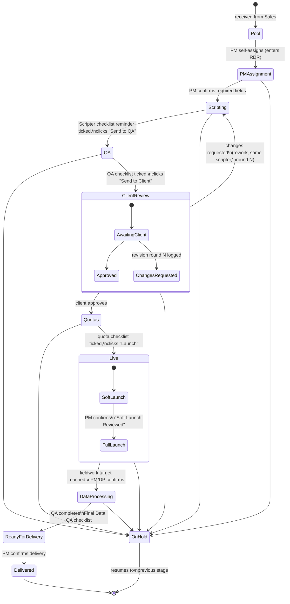

# Architecture

## 1. Lifecycle / workflow



Every arrow above is an explicit, allowed transition enforced in backend code — not just a UI convention. Any transition not drawn here is rejected by the API, regardless of what the frontend shows. This is what "difficult to accidentally bypass" means concretely: the state machine, not the button layout, is the source of truth.

**On Hold** is reachable from every active stage, always requires a reason, and is always logged. Resuming returns the project to whatever stage it was in before — recorded, not inferred. There's deliberately no separate `Cancelled` stage — a project no longer being pursued just stays `On Hold` indefinitely rather than getting its own terminal state.

## 2. Status model — four separate concepts

A single `status` column is how these systems rot. Four concepts, kept separate:

| Concept | Examples | Stored? |
|---|---|---|
| **Stage** | `PM_ASSIGNMENT`, `SCRIPTING`, `QA`, `CLIENT_REVIEW`, `QUOTAS`, `LIVE`, `DATA_PROCESSING`, `READY_FOR_DELIVERY`, `DELIVERED`, `ON_HOLD` | Yes — enum column on `projects`, DB-constrained |
| **Sub-status** | `CLIENT_REVIEW`: `AWAITING_CLIENT` / `CHANGES_REQUESTED`. `LIVE`: `SOFT_LAUNCH` / `FULL_LAUNCH` | Yes — nullable varchar on `projects`, only meaningful for stages that have one |
| **Health** | `ON_TRACK` / `AT_RISK` / `OVERDUE` | **No — always computed on read**, from days-in-stage, delivery date proximity, and soft-launch-overdue flag. Never stored, so it can never go stale. |
| **Ownership** | PM = Alice, Scripter = Ben, QA = Carol | Yes — `project_assignments`, one row per (project, role) |

## 3. Gated-confirm transitions (not full automation)

Every forward transition follows the same shape: **the checklist reminder gates the button; a human still clicks it.**

- The "Send to QA" / "Send to Client" / "Launch" / "Confirm Delivered" button is disabled until every mandatory checklist item on screen is ticked (or marked N/A).
- Clicking it is the one deliberate action that gets timestamped, attributed, and written to `stage_transitions`.

This protects against both directions of human error: skipping a step (checklist gate) and accidentally advancing a project before it's truly ready (no silent auto-advance on the last checkbox). See [`decisions/0001-gated-confirm-transitions.md`](decisions/0001-gated-confirm-transitions.md).

## 4. Checklists — static reminders, per-project tick-state

Checklist item text (Scripting, QA, Final Data QA — sourced from the existing 3Gem PDF checklists) is **hardcoded in the frontend**, not database-managed content. What's persisted is only the current tick-state for that project, as a single JSON column per checklist (e.g. `projects.scripting_checklist_state`) — so it survives a page refresh, but there's no per-item audit history and no templating/versioning system. The only checklist-related fact that lands in the audit trail is the stage-completion event itself. See [`decisions/0002-checklist-as-reminder.md`](decisions/0002-checklist-as-reminder.md).

There's no dedicated Quota checklist document — the Scripter's own checklist already covers quota setup (quotas configured, interlocks/least fill, redirect URLs, test data removed, back button behavior). The Quotas stage reuses that section rather than inventing a new one.

## 5. Client review — the app tracks the handover, it does not perform it

**Decided 2026-10-22.** "Send to client" is a **manual confirmation that the link has been sent**, not an action that sends anything. The survey link travels by the team's own email, outside this system.

Three things follow, and all three are deliberate omissions rather than gaps to fill later:

- **No link is stored.** `projects` has no test-link or live-link column. The scripter's "Test link verified" stays a tick, not a URL.
- **No client contacts.** `clients` is `id` and `name`. No contact person, no address.
- **No email.** Phase 1 notifications are in-app only (ADR 0005 deferred email for deliverability reasons); nothing here changes that.

The value is the record: who confirmed the link went out, when, and what the client said back — which is what makes turnaround time and revision counts answerable. Adding link storage or contacts later is additive and costs nothing now; building a mail path we don't need would.

## 5a. Client revision cycles

`ClientReview → Scripting` is a real backward edge in the state machine, not a special case bolted on top — see the diagram. Triggering it requires a reason and creates a `revisions` row (round number, summary, requested date). The project returns to the **same scripter** who last worked it, flagged "Rework — Round N," not back into the general scripting pool. `stage_transitions` records every forward and backward hop, so "how many rounds did this project take" and "average client turnaround" are simple queries against existing data, not a bolted-on analytics feature.

## 6. Soft launch — notification only, never a hard gate

Per explicit decision, there is **no automated pausing of fieldwork**. A scheduled job polls the CPI Dashboard progress endpoint, compares live completes against a soft-launch target frozen at 10% of the total target when the project went live (frozen, so a later target correction doesn't retroactively shift the threshold). At the threshold:

- The project is flagged `Soft Launch Due` — an action item for the PM.
- The PM manually ticks "Soft Launch Reviewed" → sub-status moves to `Full Launch`.
- If unreviewed past a grace window (default 24h, tune later), the flag becomes `Soft Launch Overdue` — visible on the dashboard, still non-blocking.

See [`decisions/0005-no-automated-pausing.md`](decisions/0005-no-automated-pausing.md).

## 7. Fieldwork data — CPI Dashboard is the source of truth

This app never talks to Askia directly and never re-implements the dual-server sync logic that already lives in `Cpi-Dashboard/backend/services/quotas.py`. Instead:

- `Cpi-Dashboard` exposes `GET /api/external/surveys/{rdr_number}/progress` (built by the user, confirmed live) returning `{"survey": "<rdr_number>", "completes": int, "target": int, "progress_pct": float}`, computed from its existing `points` table. Verified against `RDR004364` → `{"survey":"RDR004364","completes":2068,"target":2000,"progress_pct":103.4}` (2026-08-18) — note the response doesn't include IR; `fieldwork_snapshots.ir` stays `NULL` unless/until that's added.
- This app polls that endpoint on a schedule per live project and writes a row to `fieldwork_snapshots` each time — giving both current status and a pacing history, without a live dependency on every page load.
- The `/api/external/` prefix implies this is meant as a separate, external-facing surface on `Cpi-Dashboard` — worth confirming with the user whether it needs its own auth (e.g. a service-to-service API key) rather than reusing Clerk end-user auth, since this app's polling job isn't a logged-in user.

See [`decisions/0004-cpi-dashboard-integration.md`](decisions/0004-cpi-dashboard-integration.md).

## 8. Database schema (MariaDB)

```
users                  id, clerk_user_id, email, name, timezone, is_active,
                        is_head_pm_override, created_at

roles                  id, name        -- seed data: admin, pm, scripter, qa, dp, viewer

user_roles             id, user_id FK, role_id FK
                        -- UNIQUE(user_id, role_id)
                        -- a person's BASELINE job function ("is Simon a scripter at all?"),
                        -- distinct from per-project ownership below. Needed because
                        -- "can they self-assign?" can't be answered by project_assignments:
                        -- before claiming a project they hold no assignment on it.

clients                id, name

project_assignments    id, project_id FK, user_id FK, role_id FK,
                        assigned_at, unassigned_at NULL
                        -- current owner for a role = row where unassigned_at IS NULL
                        -- rows are never deleted, only closed out, so history is free

projects               id, rdr_number UNIQUE, survey_name, client_id FK,
                        survey_type VARCHAR NULL, panel_criteria TEXT,
                        stage ENUM, sub_status VARCHAR NULL,
                        final_delivery_date DATETIME NULL, final_delivery_date_locked BOOLEAN,
                        target INT NULL, soft_launch_target INT NULL,
                        live_start_date DATETIME NULL, expected_field_end_date DATETIME NULL,
                        scripting_checklist_state JSON, qa_checklist_state JSON,
                        quota_checklist_state JSON, final_qa_checklist_state JSON,
                        merged_delivery_required BOOLEAN DEFAULT TRUE,
                        created_by FK, created_at, updated_at
                        -- final_delivery_date is the MERGED/final deliverable's date,
                        -- and the only date for single-country projects.
                        -- Per-market dates live on project_markets (§16).

project_markets        id, project_id FK, country, language, is_primary BOOLEAN,
                        status ENUM, due_date DATETIME NULL,
                        live_start_date DATETIME NULL, delivered_at DATETIME NULL,
                        created_at, updated_at
                        -- UNIQUE(project_id, country)
                        -- tracking records, not workflow: no checklists, no gates,
                        -- no assignments. Absent entirely for single-country projects.

change_requests        id, project_id FK, raised_by FK users,
                        title VARCHAR(120), description TEXT,
                        status ENUM, assigned_to FK users NULL,
                        due_date DATETIME NULL, created_at, completed_at NULL
                        -- post-delivery asks (crossbreaks, retabs); the project
                        -- stays DELIVERED and never rewinds
                        -- no kind ENUM: the raiser describes the change in
                        -- their own words (see §17)

stage_transitions      id, project_id FK, from_stage, to_stage,
                        from_sub_status NULL, to_sub_status NULL,
                        changed_by FK, changed_at, reason TEXT NULL
                        -- immutable, insert-only: this table IS the project timeline

revisions              id, project_id FK, round_number INT, requested_at,
                        summary TEXT, resolved_at NULL

comments               id, project_id FK, user_id FK, body TEXT, created_at

notifications          id, user_id FK, project_id FK NULL, type, message,
                        is_read, created_at

fieldwork_snapshots    id, project_id FK, captured_at,
                        completes INT, target INT, percent_complete, ir DECIMAL NULL

audit_log              id, user_id FK, project_id FK NULL, action VARCHAR,
                        field_name VARCHAR NULL, old_value TEXT NULL, new_value TEXT NULL,
                        reason TEXT NULL, created_at
                        -- immutable; catches everything stage_transitions doesn't
                        -- (delivery-date changes, reassignments, overrides)
```

No `panels` table — panel choice is a PM judgment call each time, not a fixed controlled vocabulary, and panel/supplier identity is already owned by `Cpi-Dashboard` (its `points.supplier` / `RECONCILABLE_SUPPLIERS`). Modeling it again here would duplicate data this app doesn't own. `projects.panel_criteria` (free text, optional) is the only trace of it.

**`survey_type` is a tag, not a table.** Ten fixed values (Nat Rep/Gen-Pop, Complex surveys, Nat Rep multi-country, B2B, Multicountry B2B, Multi-country, Regional, Demographic-Specific, Occupational/Interest/Behavioral niche groups, Internal Surveys), held as a constant in backend code and validated on write — the same "static content belongs in code" reasoning as the checklists in ADR 0002. Stored directly on `projects` as a string, so no join is needed to display it. The trade accepted: no database-level constraint, and adding an eleventh type is a code change rather than an `INSERT`. Deliberately the opposite trade from `clients`, which is a real entity with its own identity.

The column is **nullable, but required to advance** — a project can be logged before its type is decided, and the PM Assignment → Scripting transition refuses until it's set. Enforcement sits at the gate rather than in the schema, matching ADR 0001.

**Keys / indexes worth calling out** — beyond the single-column indexes InnoDB creates automatically for every foreign key, the composite indexes that matter because they match real access patterns (leftmost-prefix rule: a composite index on `(a, b)` also serves lookups on `a` alone, so it replaces rather than joins a single-column index on `a`):
- `projects.rdr_number` — unique, the human-facing identifier used everywhere including the CPI Dashboard lookup.
- `projects.stage`, `projects.client_id`, `projects.final_delivery_date` — the three most common dashboard filter/sort columns.
- `project_markets (project_id, status)` — "this project's markets and where each one is," the only read pattern the markets panel has.
- `change_requests (project_id, status)` and `change_requests (assigned_to, status)` — open work on a project, and open work for a person.
- `project_assignments (project_id, role_id, unassigned_at)` — "who currently owns role X on project Y," the single most frequent query in the app.
- `stage_transitions (project_id, changed_at)`, `fieldwork_snapshots (project_id, captured_at)`, `audit_log (project_id, created_at)` — each table's real pattern is "this project's records, in time order."
- `notifications (user_id, is_read)` — "this user's unread notifications."

**Immutable by design:** `stage_transitions` and `audit_log` rows are insert-only — never updated, never deleted. That immutability is what makes them trustworthy as an audit trail; if code needs to "correct" a row, it inserts a new one referencing the old, it never edits history.

**Deliberately not modeled:** no `checklist_templates`/`checklist_items` tables (see §4), no DB-editable permission matrix (see §9) — both are real complexity this app doesn't need yet.

## 9. RBAC

Roles are fixed seed data (`admin`, `pm`, `scripter`, `qa`, `dp`, `viewer`), not user-editable in Phase 1. `Viewer` is read-only everywhere; `Admin` has full access plus user management.

**Roles operate at two levels, and the distinction matters:**

| Table | Question it answers | Used for |
|---|---|---|
| `user_roles` | "Is Simon a scripter at all?" | Global capability gates — can this person create a project, self-assign from the pool, administer users |
| `project_assignments` | "Is Simon the scripter on project 47?" | Stage-edit permission — can this person tick *this* project's scripting checklist |

`dependencies.py` exposes both as `user_global_roles()` and `user_project_roles()`, with `require_global_role(*roles)` as the dependency factory gating endpoints. `admin` passes every global check by default, handled once in the factory rather than listed on every endpoint.

A user created on first login holds **no roles at all** — they can authenticate but can do nothing until granted. Deny-by-default is deliberate.

**Permission checks live in backend code, not a database table.** A small policy module maps `(role, action)` to allowed/denied, combined with an assignment check ("is this user assigned to this project with this role, or do they hold Admin/Viewer"). Every mutating endpoint enforces this itself — never UI-only gating (the gap identified in `Cpi-Dashboard`'s reconcile permission system, worth avoiding here).

`final_delivery_date_locked`: once true, only a user with `is_head_pm_override = true` (Rose today) can change the date, and the change is written to `audit_log` with a required reason. Modeled as a boolean flag on the user, not a hardcoded name or a new role, so the override can move to a deputy later without a schema change.

## 10. Notifications

In-app only for Phase 1, no email (see `docs/phase-1-plan.md`). Triggers: project assigned to you, a project enters a stage you own (queue arrival), client requested changes (rework routed back to you), soft launch due/overdue, fieldwork target reached, a comment posted on a project you're assigned to.

## 11. Dashboard

Top of the page is a personalized **"Needs Your Attention"** list — role-aware: projects in your queue unassigned, projects assigned to you with a pending gate, overdue/at-risk projects you own. Filters below: PM, Scripter, QA, DP, Client, Panel, Stage, Health (on track / at risk / overdue), delivery window. Below that, a handful of charts: projects by stage, workload by PM/Scripter/QA, health breakdown, upcoming deadlines. Advanced analytics (stage-time averages, revision-cycle trends, client turnaround charts) are deferred to Phase 2 — the data (`stage_transitions`, `revisions`) is captured from day one regardless, so nothing about deferring the charts requires future rework.

**My Projects** is not a separate feature — it's the dashboard with `assigned_to=me` pre-applied as the default filter. No duplicated logic.

## 12. Project page

Header: RDR, survey name, client, panel, a visual stage-progress bar (current stage obvious, completed/blocked/upcoming visually distinct), health badge.

Body: current owners per role, key dates (created, live start, expected/actual delivery), the current stage's checklist reminder, comments, a merged activity timeline (`stage_transitions` + `audit_log`, chronological), fieldwork metrics (from `fieldwork_snapshots` — completes/target, soft-launch flag) once live, revision history if any rounds exist.

The page should answer, at a glance: *where is this project, who owns it, what's done, what's outstanding, what's blocking it, is it on track, what happens next.*

## 13. Rate limiting and caching

Built into the foundation layer (Slice 0), not added reactively later — see [`decisions/0007-rate-limiting-and-caching.md`](decisions/0007-rate-limiting-and-caching.md). Redis backs both:

- **Rate limiting** (`slowapi`, Redis-backed so limits hold across multiple workers/replicas): inbound limits on our own write endpoints, and outbound throttling on the CPI Dashboard polling job (§7) so it never hammers a service this app doesn't own.
- **Caching**: dashboard aggregate queries (§11 — projects-by-stage, workload, health breakdown) get a short TTL, since they're read on every dashboard load but don't need second-by-second accuracy. The client list (`GET /api/clients`, §15) uses the same pattern with a 300s TTL plus explicit invalidation on create — read on every project-creation form load, written maybe monthly. The TTL is the safety net, not the mechanism: explicit invalidation keeps the dropdown correct immediately, and staleness self-heals within five minutes if invalidation is ever missed.

  Caching is only worth a Redis round-trip when what it avoids is more expensive than that round-trip. Static vocabulary served from a Python constant (§15) is deliberately **not** cached — it is already in memory, so a cache lookup would be strictly slower.

**Never cached:** `project_assignments` permission checks (§9) — always hit the database directly. A stale "yes" on an authorization check is not a tradeoff worth making for this app, unlike a dashboard count being ten seconds old.

## 14. Time zones — UK/Kenya, travel, and daylight saving

The team spans the UK and Kenya, with people travelling between them, and delivery deadlines are set in UK time by design. This needs real handling, not a hardcoded offset — see [`decisions/0008-timezone-handling.md`](decisions/0008-timezone-handling.md) for the full reasoning. Summary:

- **Every timestamp is stored as UTC**, full stop — every `DateTime` column in §8. MariaDB's `DATETIME` type carries no timezone information itself, so this is an application-level discipline, not something the database enforces on its own.
- **UK observes daylight saving, Kenya does not** (East Africa Time is fixed at UTC+3 year-round) — meaning the UK↔Kenya gap is 3 hours for part of the year and 2 hours the rest, never a fixed number. Any "UK time" input (entering a delivery deadline) is converted to UTC using Python's `zoneinfo` with the real `Europe/London` rules, never a hardcoded `+0`/`+1`.
- **Display uses two layers:** the frontend detects the viewer's actual current browser timezone (`Intl.DateTimeFormat().resolvedOptions().timeZone`) for anything rendered live — this handles travel automatically, no manual setting needed. `users.timezone` (an IANA name, e.g. `"Africa/Nairobi"`) is the fallback for anything generated outside a live browser session, such as notification text.

## 15. API surface

**One router file per resource, named after it, with the router prefix matching the URL** — `routes/projects.py` → `/api/projects`, `routes/clients.py` → `/api/clients`. Endpoints are not filed under a loosely-related existing router just because they are short; a module name that stops describing its contents is the first sign the grouping is wrong.

The one deliberate exception is `routes/reference.py` → `/api/reference`, which groups **fixed vocabulary lists served from Python constants rather than tables**. The shared prefix is the signal: nothing under `/api/reference` is backed by a table or writable. Survey types live there today; stage names, sub-statuses and role names follow as the screens that need them are built. The rule these share is that the frontend must never hold a second hardcoded copy of a list the backend validates against — a dropdown physically cannot offer a value the API would reject.

Built and verified end-to-end as of 2026-09-14:

| Endpoint | Auth | Notes |
| --- | --- | --- |
| `GET /api/me` | any signed-in user | Does **not** yet return the user's roles — the frontend cannot gate buttons until it does |
| `GET /api/reference/survey-types` | any signed-in user | The ten values from `constants.SURVEY_TYPES` |
| `GET /api/clients` | any signed-in user | Alphabetical; Redis-cached, 300s |
| `POST /api/clients` | global `pm` | 409 on duplicate name, invalidates the cache |
| `GET /api/projects/pool` | any signed-in user | Stage `PM_ASSIGNMENT` with no open PM assignment |
| `POST /api/projects` | global `pm` | 409 duplicate RDR, 422 unknown client, 422 unknown survey type |
| `POST /api/projects/{id}/self-assign` | global `pm` | 409 if already claimed; writes `project_assignments` + `audit_log` in one commit |
| `GET /api/projects/{id}` | any signed-in user | 404 if missing; includes current owners per role |
| `POST /api/projects/{id}/send-to-scripting` | **this project's** `pm` | 403 non-owner, 409 wrong stage, 422 no survey type; first write to `stage_transitions` |
| `GET /api/roles` | any signed-in user | Seeded at migration; read-only |
| `GET /api/users` | any signed-in user | Each user with the roles they hold |
| `POST /api/users/{id}/roles` | global `admin` | 422 unknown role, 409 already held |
| `DELETE /api/users/{id}/roles/{role}` | global `admin` | 404 if not held; refuses revoking your own `admin` |
| `PATCH /api/users/{id}` | global `admin` | `is_active` / `is_head_pm_override`; refuses self-deactivation |

`send-to-scripting` is the first endpoint to check a **project** role rather than a global one. Every other mutating endpoint asks "is this person a PM at all?"; this one asks "do you hold `pm` on project 47?", because any PM in the company would otherwise pass and hand someone else's project to scripting. Checks run in the order existence → permission → state → data completeness, so a non-owner's error message never leaks whether the project's data is complete. The three failure codes are distinct on purpose: 403 never allowed, 409 the project's state conflicts, 422 your data is incomplete and the identical request will succeed once it isn't.

Project responses embed the client as a nested object (`{"client": {"id", "name"}}`) rather than a flat `client_name`, via a `lazy="joined"` relationship on `Project.client`. Joined loading is deliberate: the default `lazy="select"` would issue one query per row when serialising a list — the N+1 problem — whereas joined loading resolves the whole pool in a single statement.

**Input validation lives on the Pydantic schema, not in the handler.** It runs before the endpoint body executes, returns a 422 naming the offending field, and appears automatically in `/docs` and the OpenAPI spec. Handlers are entitled to assume their input is already well-formed.

`backend/scripts/unittests.py` exercises all of the above, success and failure paths, against a running server with the dev auth bypass enabled. It is re-runnable (unique names per run) and exits non-zero on failure so it can become a CI step unchanged.

`backend/scripts/grant_role.py` grants a baseline role straight through SQLAlchemy, bypassing the API. This is the **bootstrap path**, and it has to exist: granting `admin` through `/api/users/{id}/roles` requires `admin`, so the first administrator can never come from the API. What makes it legitimate rather than a backdoor is who can run it — it needs filesystem access and database credentials, a higher bar than holding an HTTP token, and the same bar as `alembic upgrade`. Roles are seeded by migration; *who holds them* is not, so this is needed again on every fresh schema.

## 16. Multi-country surveys — per-market tracking

See [`decisions/0009-per-market-tracking.md`](decisions/0009-per-market-tracking.md). A multi-country survey diverges after scripting: only the English link is approved and launched first, then each remaining market is translated, QA'd, client-verified and launched on its own timeline, with delivery overlapping.

`projects.stage` holds one value and so cannot express "English is LIVE while France is in QA". `project_markets` adds that grain, carrying a **status, not a stage**:

```
PENDING → TRANSLATION → QA → CLIENT_REVIEW → APPROVED → LIVE → DELIVERED
```

The primary (English) market is created at `APPROVED`, having reached that through the project's own stages. There is no per-market `ON_HOLD` — the project-level stage covers it.

**These are tracking records.** No per-market checklists, gates, notifications or assignments: the same person handles every market, and the goal is to keep a record of the steps without multiplying workflow machinery. Single-country projects have no market rows at all, and anything reading markets treats an empty list as "nothing to track".

**Lateness is per market, never project-wide.** Each market's `due_date` is what that market was promised; `delivered_at` is when it was sent. A project is late only if a market missed its own `due_date`, or the merged delivery missed `projects.final_delivery_date`. Reducing several promised dates to one produces false lateness — English due the 16th and Germany the 20th is two on-time deliveries, not one late project — and a health indicator that cries wolf gets ignored, taking the genuine late projects with it. Project health is therefore the worst state among its parts, not a comparison against any single date.

**Delivery shape varies.** Sometimes each country is sent separately then merged, sometimes only the merged file is sent; a merged file exists roughly 90% of the time. `projects.merged_delivery_required` records which applies, and a market's `delivered_at` records an interim send when one happened. Markets do **not** gate project delivery — the QA → Ready for Delivery → PM Confirms Delivered flow is unchanged, and the project page shows an advisory line ("2 markets still live") rather than disabling the button.

**Bulk gesture, individual records.** Markets are usually approved together but cannot be basketed into one record. `PATCH /api/projects/{id}/markets` takes several market ids and one status, updating each row separately so each keeps its own dates and history — batch the gesture, not the record.

Fieldwork progress stays project-level: the Cpi-Dashboard endpoint (§7) cannot split completes by country, so markets never carry completes. Deliberate boundary, not an oversight.

## 17. Post-delivery change requests

See [`decisions/0010-post-delivery-change-requests.md`](decisions/0010-post-delivery-change-requests.md). Crossbreak inclusions, retabulations and additional analysis arrive on projects that are already delivered and closed off.

`change_requests` records them alongside the project, which **stays `DELIVERED`**. Rewinding the stage to `DATA_PROCESSING` would destroy the meaning of `DELIVERED`, corrupt the cycle-time data being captured for Phase 2, and make `final_delivery_date` ambiguous. The same shape as `revisions` (§5), applied after delivery rather than before launch; kept as a separate table because the lifecycle, the owners (DP rather than scripter) and the reporting all differ.

**The change itself is free text, not a fixed vocabulary.** A short `title` for the badge and list view plus a `description` for the detail — whoever logs it defines what it is. The categories were guessed, not observed, and a wrong enum pushes real requests into `other`, where they stop being readable. Once a year of real titles exists, the common ones can become picks; narrowing later is a migration plus a backfill from data that actually happened, which is the cheap direction. Widening a wrong enum means the same migration *and* the lost detail is unrecoverable.

Anyone holding `pm`, `dp` or `admin` can raise one. PMs receive these requests but do not always log them, and a record only a PM can create is a record that will sometimes not exist — so the data team can log what a PM missed. That rule is deliberate and worth defending against a future tidy-up instinct to restrict creation to PMs.
- `final_delivery_date` and `expected_field_end_date` are real `DATETIME` columns (not bare dates) precisely because deadlines carry a specific instant, not just a calendar day.
